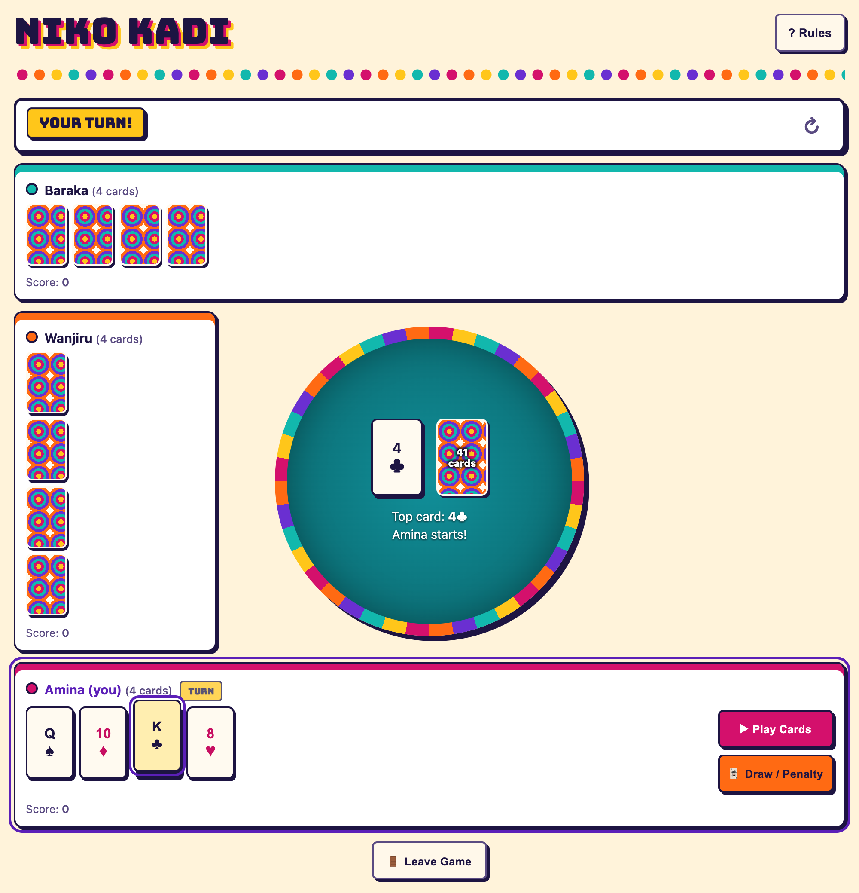
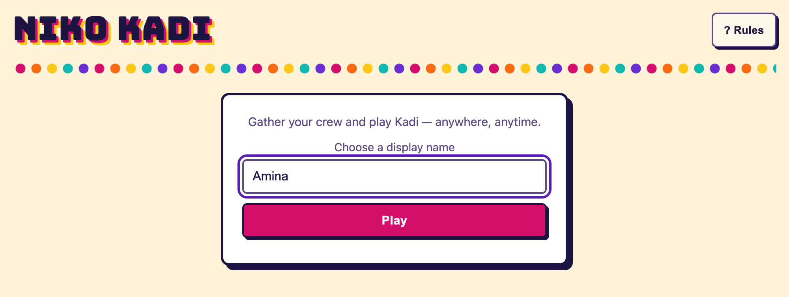
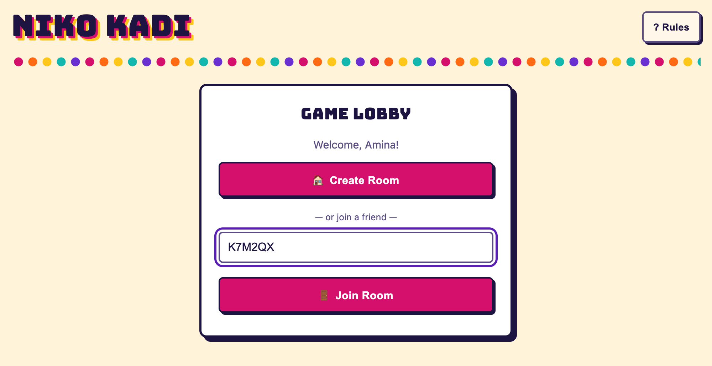
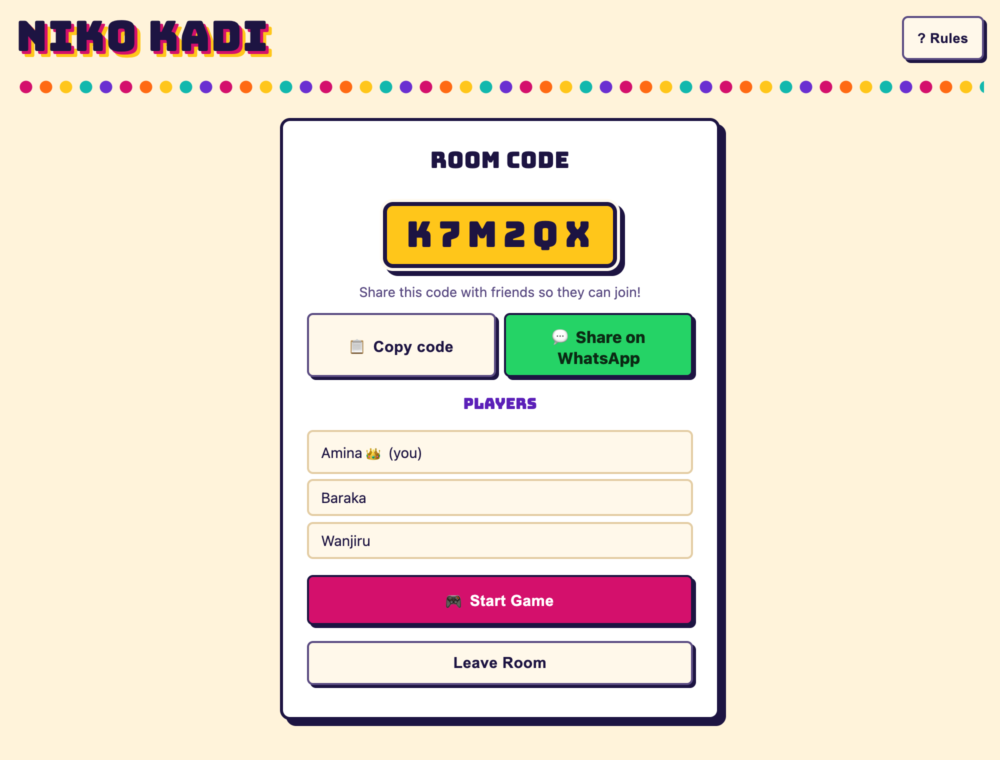
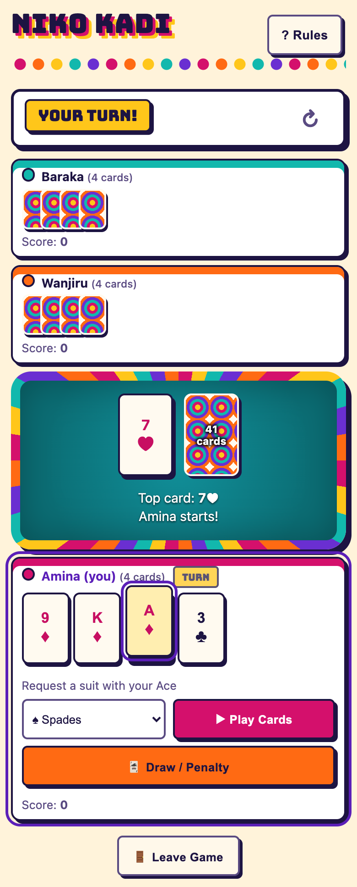
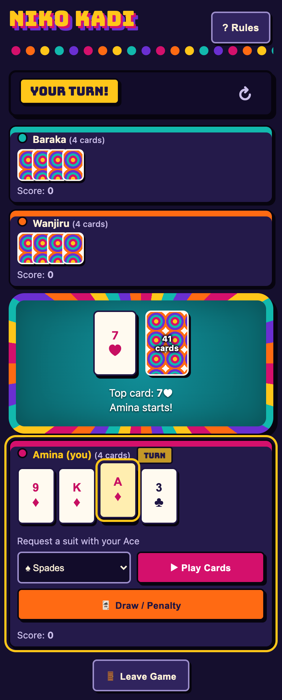
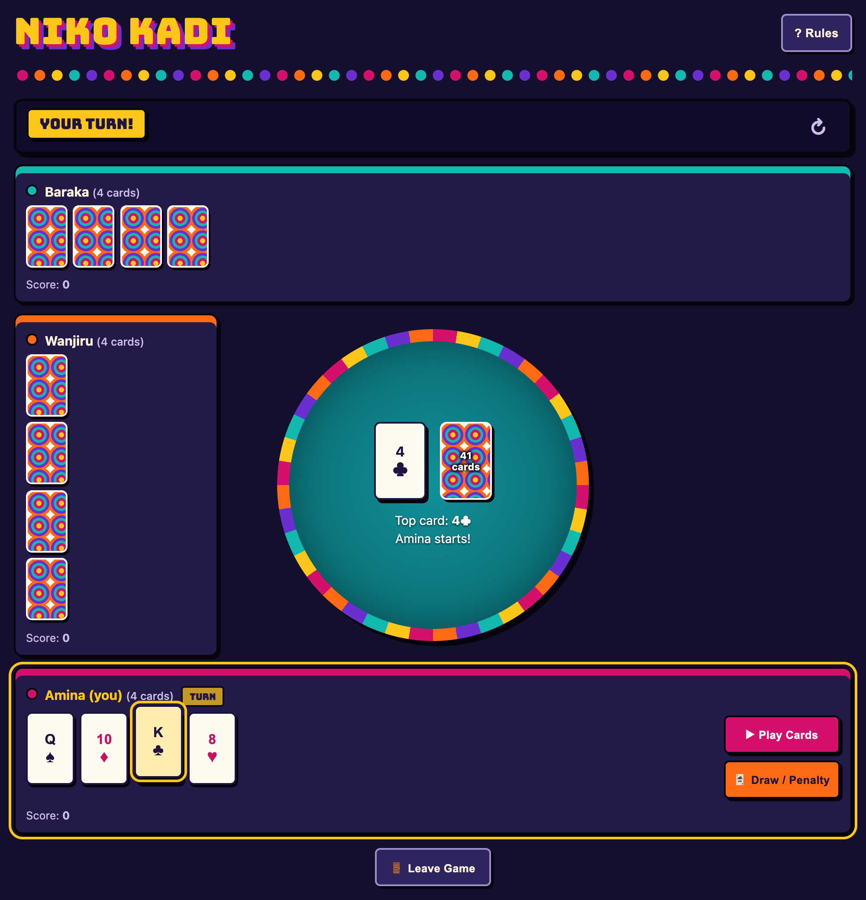

# NikoKadi

An online multiplayer version of Kadi — play with friends from anywhere.

**▶ Play now: [bethanyjep.github.io/NikoKadi](https://bethanyjep.github.io/NikoKadi/)**

<p align="center">
  
</p>

## How it works

1. Visit the [live site](https://bethanyjep.github.io/NikoKadi/) (hosted on GitHub Pages)
2. Enter a display name — no sign-up needed (anonymous auth)
3. **Create a room** to get a 6-character room code, then copy it or share it on WhatsApp (the link pre-fills the code), or **join** with a friend's code
4. Once 2+ players are in, the host starts the game (rooms hold up to 4 players)
5. Take turns playing cards — the game syncs in real time via Supabase

### Walkthrough

| 1. Pick a name | 2. Create or join a room |
|:---:|:---:|
|  |  |

| 3. Share the code, then start | 4. Play |
|:---:|:---:|
|  |  |

The game is built for phones — every opponent stays on screen and your hand sits above its action buttons:

<p align="center">
  
  
</p>

### Look and feel

A street-game vibe: bottle-cap bunting, a kitenge-print card back, a mkeka-style table rim and a different colour for every seat, with no national-flag colours. The theme follows your device, so it switches between light and dark automatically.

<p align="center">
  
</p>

### The game screen

- **Status strip:** one bar above the table that always states what's going on — whose turn it is (or "Answer the Q♠"), any pending **penalty**, any requested **suit**, and the play direction (↻ / ↺).
- **Table centre:** the top card of the discard pile, the draw pile (with its card count), and the latest game message.
- **? Rules:** a quick cheat sheet is always one tap away in the top-right corner.
- **Opponents:** shown with face-down cards, their card count, score, and a **TURN** badge for whoever is up. You are always at the bottom.
- **Your hand:** click one or more cards to select them (they lift and highlight), then use the buttons beside your hand:
  - **▶ Play Cards** — play the selected card(s)
  - **🃏 Draw / Penalty** — draw one card, or take the stacked penalty if one is pending
  - **Ace suit** — appears when an Ace is selected, to pick the suit to request
  - **📢 Niko Kadi** — declare when you have 2 or fewer cards left
  - **✓ Submit Answer** — answer a Question card (see below)
- **Next Round** appears when someone wins; scores carry over between rounds.

## Architecture

| Layer | Technology |
|-------|-----------|
| Frontend | Vanilla JS + CSS, hosted on GitHub Pages |
| Auth | Supabase Anonymous Auth |
| Database | Supabase Postgres (rooms, players, game state) |
| Real-time sync | Supabase Realtime (postgres_changes) |
| Deployment | GitHub Actions → GitHub Pages |

## Setup

### 1. Create a Supabase project

1. Go to [supabase.com](https://supabase.com) and create a free project
2. In **Authentication → Providers**, enable **Anonymous Sign-Ins**
3. Open the **SQL Editor** and run the contents of [`supabase/schema.sql`](supabase/schema.sql)
4. Copy your project **URL** and **anon key** from **Settings → API**

### 2. Configure the app

Edit `config.js` and replace the placeholders:

```javascript
var SUPABASE_URL = 'https://your-project.supabase.co';
var SUPABASE_ANON_KEY = 'your-anon-key-here';
```

The anon key is public by design — Row Level Security policies protect your data.

### 3. Run locally

```bash
python3 -m http.server 8000
```

Then visit `http://localhost:8000`.

### 4. Deploy to GitHub Pages

The repository includes a GitHub Actions workflow (`.github/workflows/deploy.yml`) that automatically deploys to GitHub Pages on every push to `main`.

To enable it:
1. Go to **Settings → Pages** in your GitHub repo
2. Set the source to **GitHub Actions**
3. Push to `main` — the site will deploy automatically

## Game rules

### Setup

- **54-card deck** (standard 52 + 2 Jokers).
- Each player is dealt **4 cards** (2–3 players) or **3 cards** (4 players).
- One card is turned face up to start the discard pile. The starting card is never a 2, 3, A, J, K, Q, 8 or Joker.
- Play moves clockwise; the first player in the room goes first.

### On your turn

Play a card that matches the top card by **suit or rank**, or **draw a card** (which ends your turn). You can play several cards at once if they share the same rank (e.g. 7♥ + 7♠), or are Q/8 cards chained by matching suits.

### Special cards

| Card | Type | Effect |
|------|------|--------|
| **2** | Penalty | Next player draws 2 — unless they block |
| **3** | Penalty | Next player draws 3 — unless they block |
| **Joker** | Penalty | Next player draws 5; can be played on anything and keeps the previous suit in force |
| **A** | Ace | Can be played on anything; you **request a suit** that the next card must match. An Ace also blocks a pending penalty |
| **J** | Jump | Skips the next player |
| **K** | Kickback | Reverses the direction of play |
| **Q / 8** | Question | You must **answer** it in the same turn (see below) |
| **4–10** | Answer | Plain number cards; used to answer Questions and to win |

### Penalties

- A penalty can be **stacked**: block a penalty by playing a matching 2 or 3 (same suit/rank as the top card), a Joker, or an Ace. Stacking adds to the total, and the next player faces the bigger penalty.
- Playing an **Ace** cancels the pending penalty entirely.
- If you can't (or won't) block, press **Draw / Penalty** to take the full amount and end your turn.

### Questions (Q and 8)

After you play a Q or 8 you must answer it:

- If you hold a matching **answer card** (4–10 sharing the question's suit or rank), you pick the card(s) and press **Submit Answer**. Multiple answer cards are fine if they all have the **same number** and at least one matches the Question's suit.
- If you have no answer, you automatically draw 1 card.

### Niko Kadi — declaring and winning

- When your hand is down to **2 cards or fewer**, press **📢 Niko Kadi**. You can declare right after playing, even once your turn has passed, but you **must** declare before playing your last card.
- To win, empty your hand while declared, using a **winning card**: an answer card (4–10) or a Question card (Q/8) with a valid answer. You **cannot** win by finishing on A, 2, 3, J, K or Joker.
- If you go out without declaring, or finish on a non-winning card, you draw 1 penalty card and play continues.
- Drawing a card un-declares you — declare again once you're back to 2 cards or fewer.

### Scoring

The winner scores the total value of all cards left in the other players' hands. Totals carry across rounds.

| Card | Points |
|------|--------|
| Joker | 500 |
| A | 100 |
| 2 | 75 |
| 3 | 50 |
| 10, J, Q, K | 10 each |
| 4–9 (and 8) | face value |

## Tests

```bash
node --test
```
