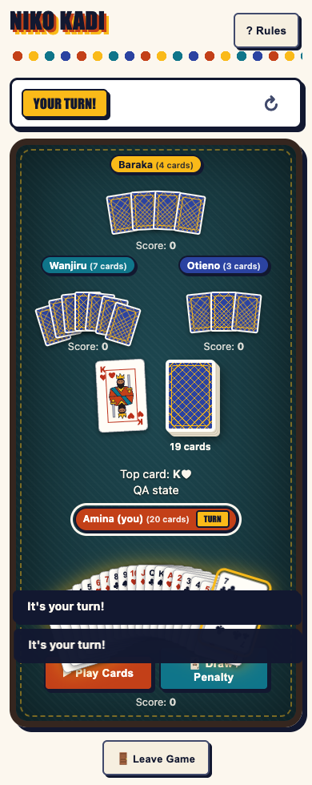
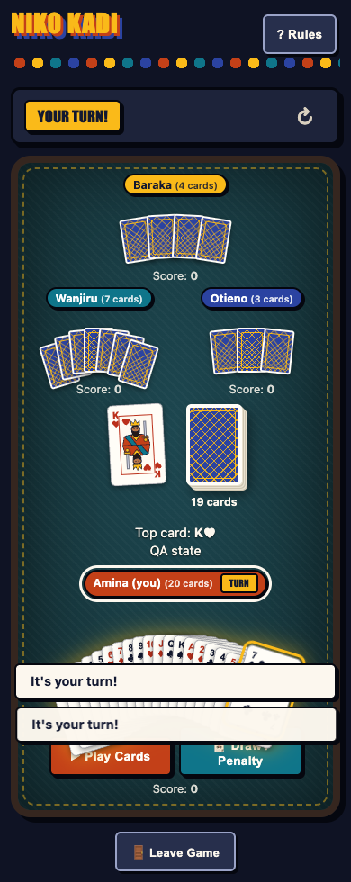
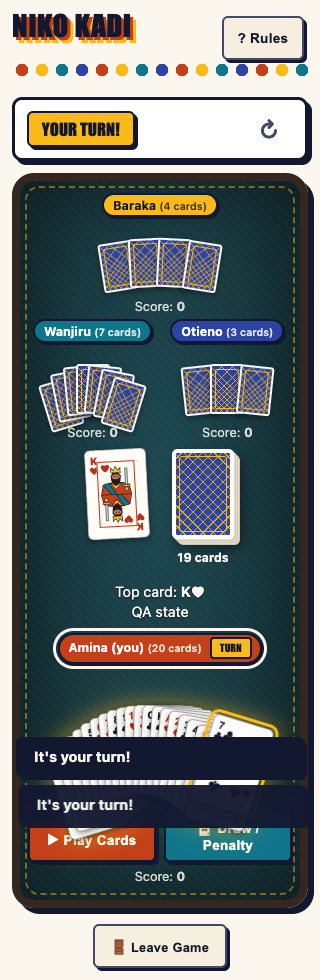
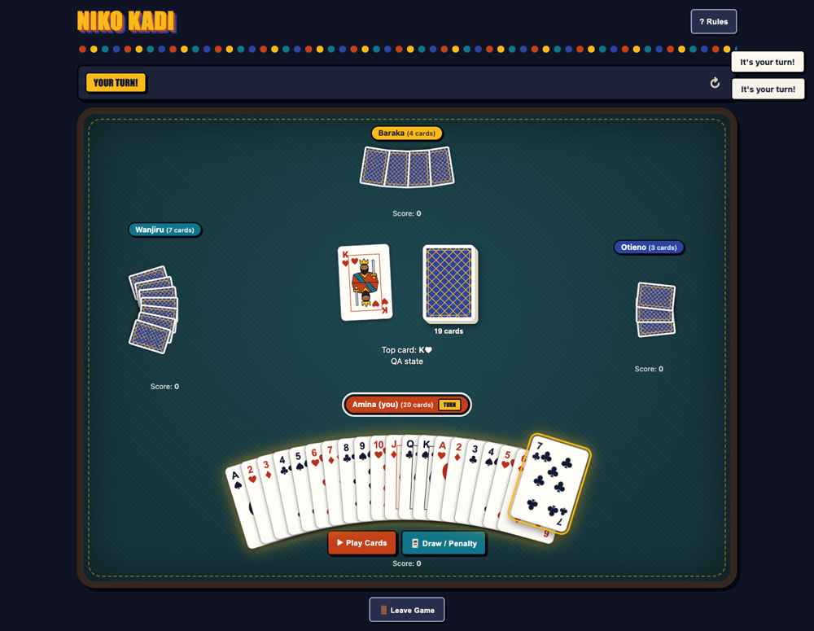

# QA report

Automated end-to-end QA of the card-table build, run in headless Chromium with Supabase stubbed (no network). Each check is a real DOM/behaviour assertion, not a screenshot comparison.

**Result: 63/63 checks pass** (after the three fixes listed below). Covered: static integrity, join and lobby, room and invite, rules, full game flow, all 52 card faces plus the Joker, responsive layout, contrast, keyboard and screen readers, motion, theming and console errors.

## Summary by area

| Area | Passed | Checks |
|---|---|---|
| Static | 7/7 | No duplicate HTML ids; All SVG art symbols defined; README images all exist (4)... |
| Auth | 2/2 | Empty name shows an error and stays on join screen; Enter key submits name |
| Lobby | 1/1 | Unknown room code shows an error |
| Room | 5/5 | Room code is 6 characters; Host sees Start Game and 3 players listed; WhatsApp link includes invite URL with ?room=... |
| Rules | 7/7 | Rules dialog opens; Rules dialog has all rule sections; Escape closes rules dialog... |
| Game | 4/4 | 3-player deal: 3 seats, 4 cards each; Exactly one seat shows the turn light; Opponent hands are face-down (no rank text leaks)... |
| Turns | 3/3 | Cards cannot be selected on someone else's turn; No Play/Draw buttons on someone else's turn; My turn shows Play/Draw controls |
| Select | 1/1 | Click selects a card (aria-pressed + Play button) |
| Table | 1/1 | Discard pile now shows the played card on top |
| Ace | 3/3 | Suit picker hidden until an Ace is selected; Suit picker appears with 4 suits; Playing Ace sets the required suit chip |
| Penalty | 2/2 | Penalty chip and hint shown; Taking the penalty draws 2 cards |
| Question | 3/3 | Answer mode prompt + status chip; Submit Answer appears once a card is selected; Submitting an answer resolves the question |
| Niko | 2/2 | Declare button available with ≤2 cards even off-turn; Declaration is shown on my seat |
| Win | 3/3 | Confetti, Round over chip, Next Round button; No turn light after round ends; Next Round deals a fresh hand and clears confetti |
| Layout | 2/2 | 2-player table renders (1 opponent); 4-player table renders 4 seats with 4 colours |
| Cards | 3/3 | All 52 faces: correct pip count, court art, 2 corners, right suit symbol; SVG symbols resolve in the DOM; Hearts/diamonds red, spades/clubs dark |
| Responsive | 2/2 | No horizontal scroll, off-screen cards, or <44px controls (320–1440px, light+dark, 20-card hand, 4 players); Side-seat hands never overlap the table centre |
| Contrast | 2/2 | Key text ≥ 4.5:1 (light); Key text ≥ 4.5:1 (dark) |
| Keyboard | 4/4 | Tab reaches a hand card; Focused card has a visible focus ring; Enter selects the focused card... |
| A11y | 4/4 | Hand cards have accessible names; Live region announces game state; Decorative SVG art hidden from screen readers... |
| Theme | 1/1 | Page background follows device scheme (dark ≠ light) |
| Console | 1/1 | No JS errors or console errors across all runs |

## Issues found and fixed

| # | Severity | Issue | Fix |
|---|---|---|---|
| 1 | Medium | At 320px and 360px, a long hand (20 cards after stacked penalties) overflowed the screen: 33px horizontal scroll and up to 4 cards off-screen | `fitHands()` in `app.js` tightens the overlap until the hand fits its seat, and re-runs on resize |
| 2 | Medium | A long hand's outer cards sagged ~140px and covered the Play and Draw buttons | The sag is now capped per hand (`--drop`), unchanged for normal hands |
| 3 | Medium | Keyboard focus was lost after every card toggle, because the board re-renders. Keyboard users had to tab from the top each time | `renderGame` restores focus to the same card or button after rendering |

## Responsive matrix

Worst case: 4 players, 20-card hand. Horizontal scroll (px), cards off-screen, opponent hands off-screen, controls under 44px, side hand overlapping table centre.

| Scheme | Width | Scroll | Cards off-screen | Opp. off-screen | Small targets | Overlap |
|---|---|---|---|---|---|---|
| light | 320 | 0 | 0 | 0 | 0 | no |
| light | 360 | 0 | 0 | 0 | 0 | no |
| light | 390 | 0 | 0 | 0 | 0 | no |
| light | 768 | 0 | 0 | 0 | 0 | no |
| light | 1024 | 0 | 0 | 0 | 0 | no |
| light | 1440 | 0 | 0 | 0 | 0 | no |
| dark | 320 | 0 | 0 | 0 | 0 | no |
| dark | 360 | 0 | 0 | 0 | 0 | no |
| dark | 390 | 0 | 0 | 0 | 0 | no |
| dark | 768 | 0 | 0 | 0 | 0 | no |
| dark | 1024 | 0 | 0 | 0 | 0 | no |
| dark | 1440 | 0 | 0 | 0 | 0 | no |

## Screenshots

| Light, 390px | Dark, 390px |
|---|---|
|  |  |

| Light, 320px, 20-card hand | Dark, desktop 1440px |
|---|---|
|  |  |

## Full check list

### Static

- PASS - No duplicate HTML ids
- PASS - All SVG art symbols defined
- PASS - README images all exist (4)
- PASS - No undefined CSS variables
- PASS - CSS honours reduced-motion and dark scheme
- PASS - No Kenyan-flag hex colours in CSS
- PASS - Exactly four brand colours defined (clay,saffron,teal,indigo)

### Auth

- PASS - Empty name shows an error and stays on join screen (Please enter a display name.)
- PASS - Enter key submits name

### Lobby

- PASS - Unknown room code shows an error (Room not found or game already finished.)

### Room

- PASS - Room code is 6 characters (K7M2QX)
- PASS - Host sees Start Game and 3 players listed
- PASS - WhatsApp link includes invite URL with ?room= (https://wa.me/?text=Join%20my%20Niko%20Kadi%20game!%20Room%20code%3A%20K7M2QX%20%E2%80%94%)
- PASS - Copy code gives feedback (toast) (Room code K7M2QX copied)
- PASS - Invite link ?room= pre-fills the join code (K7M2QX)

### Rules

- PASS - Rules dialog opens
- PASS - Rules dialog has all rule sections
- PASS - Escape closes rules dialog
- PASS - Focus returns to Rules button (rulesBtn)
- PASS - Non-matching play is rejected, hand unchanged (Top card: 7♥9♣ does not match. Draw a card instead.)
- PASS - Matching play (5♥ on 7♥) removes it and passes turn (hand 4)
- PASS - Draw adds one card to hand (2 -> 3)

### Game

- PASS - 3-player deal: 3 seats, 4 cards each (3 seats / 4)
- PASS - Exactly one seat shows the turn light
- PASS - Opponent hands are face-down (no rank text leaks)
- PASS - Deck count matches remaining cards (41 cards)

### Turns

- PASS - Cards cannot be selected on someone else's turn
- PASS - No Play/Draw buttons on someone else's turn
- PASS - My turn shows Play/Draw controls

### Select

- PASS - Click selects a card (aria-pressed + Play button)

### Table

- PASS - Discard pile now shows the played card on top

### Ace

- PASS - Suit picker hidden until an Ace is selected
- PASS - Suit picker appears with 4 suits
- PASS - Playing Ace sets the required suit chip (Suit: ♠)

### Penalty

- PASS - Penalty chip and hint shown (Penalty: draw 2)
- PASS - Taking the penalty draws 2 cards (hand 6)

### Question

- PASS - Answer mode prompt + status chip (Answer the Q♠)
- PASS - Submit Answer appears once a card is selected
- PASS - Submitting an answer resolves the question (Top card: 5♠Amina answered with 5♠)

### Niko

- PASS - Declare button available with ≤2 cards even off-turn
- PASS - Declaration is shown on my seat (Score: 0 • ✅ Niko Kadi declared)

### Win

- PASS - Confetti, Round over chip, Next Round button
- PASS - No turn light after round ends
- PASS - Next Round deals a fresh hand and clears confetti (hand 4)

### Layout

- PASS - 2-player table renders (1 opponent)
- PASS - 4-player table renders 4 seats with 4 colours

### Cards

- PASS - All 52 faces: correct pip count, court art, 2 corners, right suit symbol
- PASS - SVG symbols resolve in the DOM ([true,true,true,true,true,true,true,true])
- PASS - Hearts/diamonds red, spades/clubs dark (rgb(187, 48, 27) rgb(187, 48, 27) rgb(18, 24, 48) rgb(18, 24, 48))

### Responsive

- PASS - No horizontal scroll, off-screen cards, or <44px controls (320–1440px, light+dark, 20-card hand, 4 players) ([])
- PASS - Side-seat hands never overlap the table centre ([])

### Contrast

- PASS - Key text ≥ 4.5:1 (light) (min 5.16)
- PASS - Key text ≥ 4.5:1 (dark) (min 5.16)

### Keyboard

- PASS - Tab reaches a hand card
- PASS - Focused card has a visible focus ring
- PASS - Enter selects the focused card
- PASS - Focus is kept after re-render (BUTTON)

### A11y

- PASS - Hand cards have accessible names
- PASS - Live region announces game state (Your turn!. QA state Penalty: 2 cards.)
- PASS - Decorative SVG art hidden from screen readers
- PASS - Reduced motion: confetti hidden

### Theme

- PASS - Page background follows device scheme (dark ≠ light) (dark rgb(15, 19, 36) / light rgb(252, 247, 238))

### Console

- PASS - No JS errors or console errors across all runs

## Known issues, not part of this change

- `test/game.test.js` "round score sums remaining card points" fails (expects 37, gets 590). It fails the same way on `main`; the test's fixture does not match the Joker 500 / Ace 100 scoring in `game.js`.
- Not covered: real Supabase auth and Realtime latency, concurrent multi-device play, and Safari/Firefox rendering (QA ran on Chromium only).
- Google Fonts were blocked during QA, so Bungee headings rendered with the Impact fallback.

## How it was run

Playwright drives the static site served locally, with a stubbed Supabase client that lets the test push arbitrary game states into the real UI code path. Contrast is computed from resolved colours (the felt gradient is treated as its lightest stop).
